<!-- @format -->

<h1 align="center">Hi, I'm Mahdi Salek 👋</h1>

  <strong>Senior Product-Minded Front-End Engineer</strong>
   
  <strong>Vue.js · Nuxt.js · TypeScript</strong>
   
   
  📍 Yerevan, Armenia &nbsp;|&nbsp; 🌐 <a href="https://mahdis24.tech">Portfolio</a>

 

  
  
  
  

 

## 👨‍💻 About Me

**Senior Product-Minded Front-End Engineer** with **7+ years** of experience architecting and scaling modern web applications using **Vue.js**, **Nuxt.js**, **Vuetify.js**, and **TypeScript**. Currently leading front-end modernization for enterprise platforms in Sweden.

- ⚡ **Performance & Architecture:** Proven track record of migrating 100+ legacy modules, cutting page load times by **60%+** via SSR & code splitting, and reducing initial bundle sizes by **75%**.
- 🧩 **Design Systems & DX:** Experienced in consolidating complex UIs into reusable component libraries, reducing codebase bloat by **~70%**, and establishing standards that cut PR review times in half.
- 🚀 **Product-Minded Delivery:** Comfortable owning features end-to-end—from translating stakeholder requirements and UI/UX flows into clean architecture, to automating CI/CD pipelines with Docker and GitHub Actions.

 

## 🟢 Open to Senior Front-End Roles

- **Remote**: Worldwide
- **Relocation**: Europe & Australia
- **On-site / Hybrid**: Yerevan, Armenia

 

## 🛠️ Tech Stack

**Core Front-End**

  

**Tooling, Testing & DevOps**

  

**Architecture & Practices**

  
  
  
  
  
  

 

## 🌐 Languages

- **English:** Professional Working Proficiency
- **German:** Limited Working Proficiency
- **Persian:** Native

 

## 📊 GitHub Activity

 

## 📫 Get in Touch

- **Website:** [mahdis24.tech](https://mahdis24.tech)
- **LinkedIn:** [linkedin.com/in/mahdi-s24](https://linkedin.com/in/mahdi-s24)
- **Email:** [mahdi.6n@gmail.com](mailto:mahdi.6n@gmail.com)
- **Telegram:** [@mahdi_s24](https://t.me/mahdi_s24) (Fastest response)
- **Resume:** [Download PDF](https://mahdis24.tech/assets/Mahdi_Salek_Front_End_Engineer.pdf)
